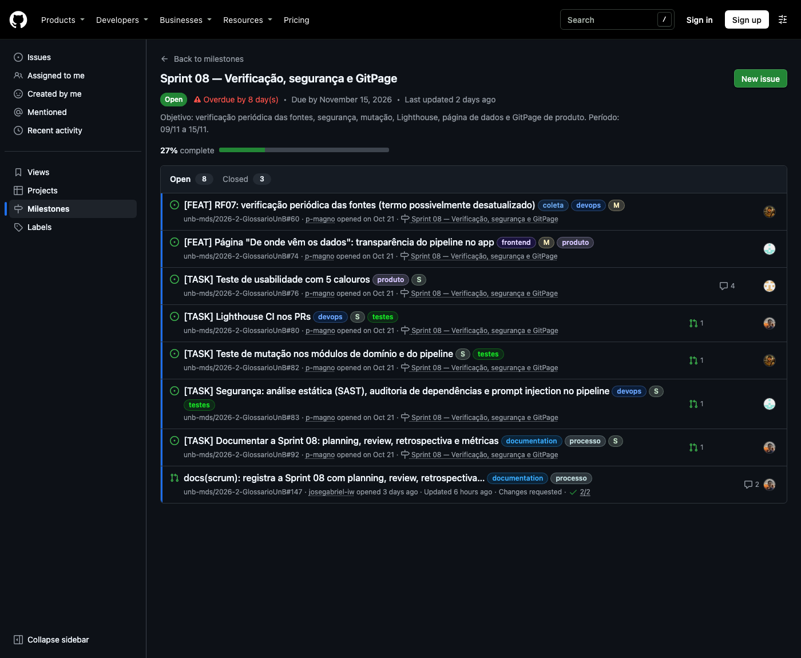
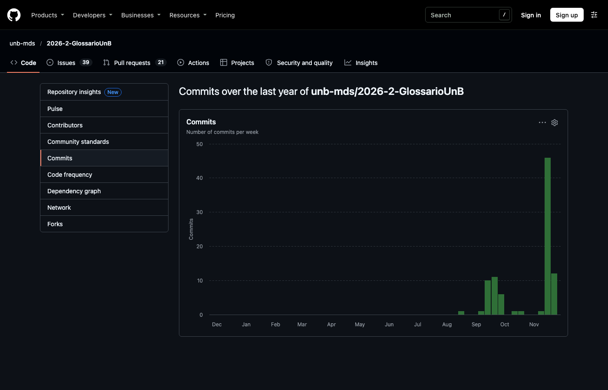

# Sprint 08 — Verificação, segurança e GitPage (09/11 a 15/11/2026)

Registro escrito em 19/11/2026 a partir do GitHub (milestone, issues, PRs e commits) e do [`dailies.md`](../dailies.md), porque a sprint não teve registro na época. Responsável por este registro: José (#92).

## Planning

**Objetivo (milestone):** verificação periódica das fontes, segurança, mutação, Lighthouse, página de dados e GitPage de produto.

O planejamento das Sprints 04 a 09 foi dividido na reunião de 12/10 e as issues e o milestone foram criados no GitHub em 21/10.

| Issue | Tamanho | Pontos | Responsável |
|---|---|---|---|
| #60 RF07: verificação periódica das fontes (termo possivelmente desatualizado) | M | 2 | Allan |
| #74 Página "De onde vêm os dados": transparência do pipeline no app | M | 2 | Ítalo |
| #75 GitPage como visão de produto centrada no usuário | M | 2 | Pedro |
| #76 Teste de usabilidade com 5 calouros | S | 1 | Pedro |
| #80 Lighthouse CI nos PRs | S | 1 | José |
| #82 Teste de mutação nos módulos de domínio e do pipeline | S | 1 | Allan |
| #83 Segurança: análise estática (SAST), auditoria de dependências e prompt injection no pipeline | S | 1 | Ítalo |
| #92 Documentar a Sprint 08: planning, review, retrospectiva e métricas | S | 1 | José |
| **Total** | | **11** | |

Pontos: S = 1, M = 2, L = 3, XL = 5.

> O milestone [Sprint 08 — Verificação, segurança e GitPage](https://github.com/unb-mds/2026-2-GlossarioUnB/milestone/9) também recebeu em 17/11 a issue `#113` (*Registrar a ata do encontro (11/11) no `dailies.md`*, Ítalo, sem label de tamanho, fechada em 18/11 pelo PR `#115`); ela não fazia parte do backlog planejado no início da sprint.

## Review

- **Entregue da Sprint 08 no período (09/11 a 15/11):** nenhuma das 8 issues planejadas no milestone foi fechada nessa semana (0 de 11 pontos).
- **Entregas e movimentações no repositório durante a janela (09/11 a 15/11):**
  - **PR mergeado (outra sprint):** [#33](https://github.com/unb-mds/2026-2-GlossarioUnB/pull/33) (`e6c236e`, José), mergeado em 10/11, fechando a issue `#17` (Sprint 01, 1 ponto).
  - **PRs abertos no período (4):** [#99](https://github.com/unb-mds/2026-2-GlossarioUnB/pull/99) (09/11, José, `#97`), [#100](https://github.com/unb-mds/2026-2-GlossarioUnB/pull/100) (13/11, Allan, `#43`), [#101](https://github.com/unb-mds/2026-2-GlossarioUnB/pull/101) (14/11 23h17 BRT, Pedro, `#57` — mergeado em 17/11) e [#102](https://github.com/unb-mds/2026-2-GlossarioUnB/pull/102) (14/11 23h55 BRT, Pedro, `#53` — mergeado em 17/11).
  - **Outras movimentações:** Encontro 1 em 11/11 com todos os 5 integrantes definindo o fluxo *1 issue = 1 branch = 1 PR*; atualizações de Allan nos PRs `#45` (`97d3af7`) e `#41` (`94924bb`) em 14/11; commit `9f14b1f` de José em `feature/issue-65` em 15/11.
- **O que ficou e onde está cada issue da Sprint 08 em 19/11/2026:**
  - `#75`: fechada em 18/11 pelo PR [#105](https://github.com/unb-mds/2026-2-GlossarioUnB/pull/105) (`f064566`, Pedro).
  - `#113` *(adicionada em 17/11)*: fechada em 18/11 pelo PR [#115](https://github.com/unb-mds/2026-2-GlossarioUnB/pull/115) (`2fbd7d4`, Ítalo).
  - `#80`: branch `chore/issue-80-lighthouse-ci` (`a6e02e6`, José) enviada em 19/11, aguardando abertura e revisão de PR.
  - `#83`: correção parcial de redirecionamento aberto (SonarQube S5146) entrou em 18/11 pelo PR [#128](https://github.com/unb-mds/2026-2-GlossarioUnB/pull/128) (`00f47e9`, Pedro); escopo restante com o Ítalo segue aberto.
  - `#82`: `@stryker-mutator/core` liberado na ADR 0010 pelo PR [#131](https://github.com/unb-mds/2026-2-GlossarioUnB/pull/131) em 18/11; implementação com o Allan segue aberta.
  - `#60` (Allan), `#74` (Ítalo) e `#76` (Pedro): seguem abertas, sem PR.
  - `#92`: este registro.

## Retrospectiva

Feita depois da sprint (19/11), comparando com as Sprints 04 e 05 (as Sprints 06 e 07 — `#90` e `#91` — ainda não têm registro fechado).

**O que funcionou**
- Retomada real do ritmo de trabalho após o Encontro 1 (11/11), com todos os 5 integrantes presentes e o fluxo *1 issue = 1 branch = 1 PR* alinhado na prática.
- Voltou a haver atividade de commits (8 commits em 4 branches/PRs diferentes) e abertura de 4 PRs, além do primeiro merge de backlog atrasado (`#33`).

**O que não funcionou**
- O time seguiu priorizando backlog atrasado das Sprints 01, 04, 06 e 07 enquanto nenhuma das 8 issues da própria Sprint 08 fechou no período.
- PRs continuaram parados aguardando revisão ou resolução de comentários (`#41`, `#45`, `#99`, `#100`).
- A sprint terminou novamente sem o registro de review, retrospectiva e métricas na data prevista.

**Problemas que se repetem** *(critério do time: não se repetir por mais de 2 sprints)*
- **PR aberto parado sem revisão/merge:** apareceu na Sprint 04, repetiu na Sprint 05 e voltou na Sprint 08 (**ultrapassou o limite de 2 sprints**).
- **Documentação de sprint e ata atrasadas:** apareceu nas Sprints 04 e 05 (Sprints 06 e 07 também estão em aberto) e repetiu na Sprint 08 (**ultrapassou o limite de 2 sprints**).
- **Velocity 0 nas issues do próprio milestone:** repetiu o padrão das Sprints 04 e 05, embora nesta semana tenha havido 1 entrega da Sprint 01 (`#17`) e 4 PRs abertos.

**Ações, com responsável** *(encaminhadas para a Sprint 09 e validadas no Encontro 2 de 16/11)*
- [ ] Fechar as issues pendentes da R2 na ordem de dependência (meta reajustada no Encontro 2 de 16/11 para 19/11, após a saída da Jéssyca e redistribuição das tarefas) — Todos.
- [ ] Manter SLA de revisão de PR em até 24h (quem abre marca revisor; quem revisa roda `npm test` localmente e registra comentário técnico) — Todos.
- [ ] Regularizar os registros pendentes das sprints e atas (`#90`, `#91`, `#93`; a ata de 16/11 `#114` já fechou pelo PR `#126`) — Ítalo (Scrum Master), com apoio do time.

## Métricas

Levantadas em 19/11/2026 via API do GitHub e `git log` para a janela oficial da Sprint 08 (09/11 a 15/11/2026, horário de Brasília `-03:00`).

| Métrica | Sprint 08 |
|---|---|
| Issues comprometidas | 8 (11 pontos) |
| Issues fechadas (Sprint 08) | 0 (0 pontos) |
| Issues fechadas (outras sprints) | 1 (`#17` — Sprint 01, 1 ponto) |
| PRs abertos | 4 (`#99`, `#100`, `#101`, `#102`) |
| PRs mergeados | 1 (`#33`) |
| PRs fechados sem merge | 0 |
| Commits (todas as branches, sem merges) | 8 |
| Velocity | 0 pontos (Sprint 08) · 1 ponto (total no período) |

**Commits por pessoa no período (09/11 a 15/11):**
- **Allan (`MrD4ntas`):** 3 (`ee9e6df`, `97d3af7`, `94924bb`)
- **José (`josegabriel-iw`):** 3 (`da3621d`, `e6c236e`, `9f14b1f`)
- **Pedro (`p-magno`):** 2 (`960c127`, `d58031b`)
- **Ítalo (`smitalo`):** 0
- **Jéssyca (`Jessy2126`):** 0

**Encaminhamento:** diferente das Sprints 04 e 05 (que tiveram 0 commits), a Sprint 08 marcou a retomada de produção e abriu a onda de entregas que passaram a entrar na `main` entre 17/11 e 19/11. Ainda assim, o atraso acumulado e os PRs parados mostram que o gargalo está na cadência de revisão e no fechamento dentro da semana da sprint — ponto crítico para garantir tudo na `main` antes da entrega da R2 em 25/11.

## Prints

Prints tirados em 23/11/2026, depois do fim da sprint.

**Milestone da Sprint 08** ([Milestone 9](https://github.com/unb-mds/2026-2-GlossarioUnB/milestone/9)), com os itens ainda abertos em 23/11:

**Gráfico de commits** por semana ([Insights → Commits](https://github.com/unb-mds/2026-2-GlossarioUnB/graphs/commit-activity)):

## Atas

A pasta `docs/scrum/atas/` foi unificada em [`dailies.md`](../dailies.md) (decisão registrada no commit `f06b07b`). A reunião realizada durante a Sprint 08 foi o **Encontro 1 (Quarta, 11/11/2026, 13h25 às 13h52, 5 presentes)**, registrado em [`dailies.md`](../dailies.md) e fechado pela issue `#113` (PR `#115`).
