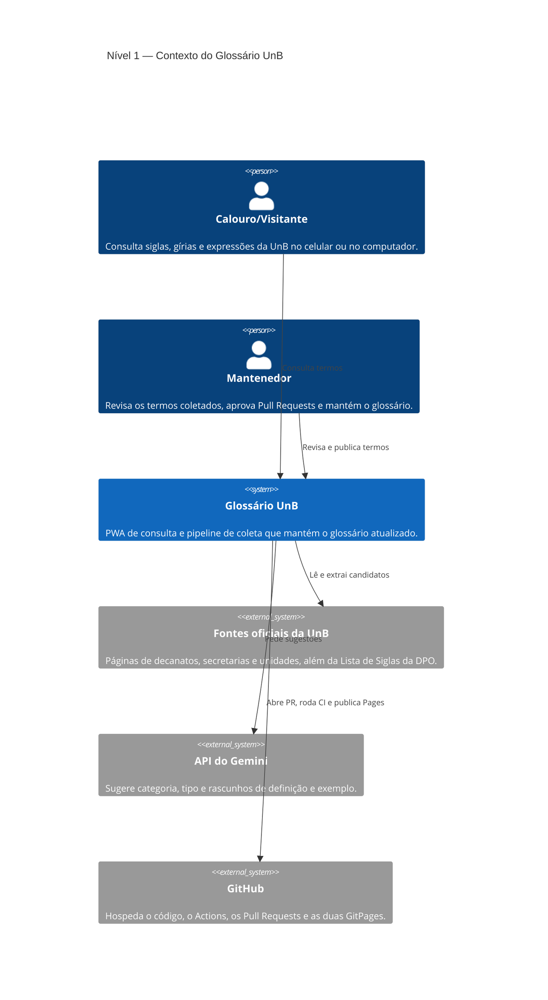
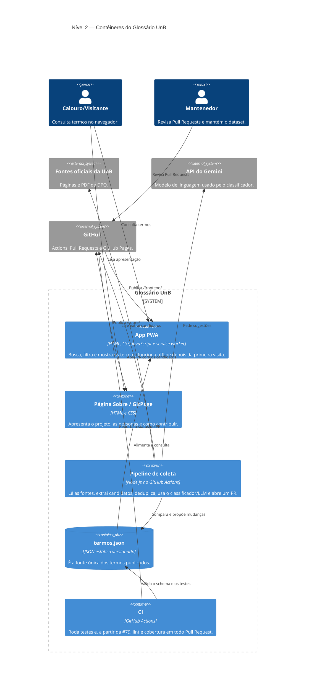

# Arquitetura — Glossário UnB

Dicionário colaborativo de termos da UnB. Requisitos completos em [`REQUISITOS.md`](REQUISITOS.md).

## Arquitetura C4

Os diagramas abaixo usam a notação C4 (contexto e contêineres). O nível 1 mostra o sistema como uma caixa-preta; o nível 2 abre a caixa e mostra o que roda e onde. O pipeline segue a [ADR 0009](adr/0009-coleta-automatizada-por-pipeline.md).

### Nível 1 — Contexto

O Glossário UnB é o sistema no centro. Quem consulta e quem mantém são pessoas; as fontes oficiais, a API do Gemini e o GitHub são sistemas externos. O pipeline de coleta faz parte do Glossário UnB, mesmo rodando no GitHub Actions.



**Elementos do contexto:**

| Elemento | Tipo | Uma frase |
|---|---|---|
| Calouro/Visitante | Pessoa | Consulta o significado de um termo no celular ou no computador. |
| Mantenedor | Pessoa | Revisa os candidatos, aprova Pull Requests e mantém o dataset. |
| Glossário UnB | Sistema | Reúne o app de consulta e o pipeline que mantém os termos atualizados. |
| Fontes oficiais da UnB | Sistema externo | Fornecem os termos, as siglas e o contexto oficial. |
| API do Gemini | Sistema externo | Sugere categoria, tipo e rascunhos para a revisão humana. |
| GitHub | Sistema externo | Guarda o código, executa o Actions, hospeda os Pull Requests e publica as GitPages. |

### Nível 2 — Contêineres

O nível 2 mostra os contêineres dentro do Glossário UnB. O app e a página Sobre são publicados como arquivos estáticos no GitHub Pages; o pipeline e o CI rodam no GitHub Actions. Não há backend nem banco de dados: o `termos.json` versionado é a fonte única.



**Contêineres:**

| Contêiner | Tecnologia | Uma frase |
|---|---|---|
| App PWA | HTML, CSS, JavaScript e service worker | Consulta os termos, com busca, filtros e uso offline depois da primeira visita. |
| Página Sobre / GitPage | HTML e CSS | Apresenta o projeto, as personas e os caminhos de contribuição, sem JavaScript. |
| Pipeline de coleta | Node.js no GitHub Actions | Lê as fontes, extrai candidatos, deduplica, usa o classificador/LLM e abre um PR. |
| termos.json | JSON estático versionado | Guarda os termos publicados e é a fonte única do app. |
| CI | GitHub Actions | Roda testes e, a partir da #79, lint e cobertura em todo Pull Request. |

### Fluxo de dados

1. O pipeline lê `coleta/fontes.json` e extrai candidatos com URL, trecho e data da coleta.
2. A deduplicação compara os candidatos com o `termos.json` e separa novos, alterados e conflitos.
3. O classificador/LLM sugere categoria, tipo e rascunhos; `validarGlossario()` confere o schema.
4. O workflow abre um Pull Request; uma pessoa revisa, escreve a definição e o exemplo e faz o merge.
5. O `termos.json` na `main` é copiado para o GitHub Pages; o app PWA consulta e o service worker guarda os dados para uso offline.
6. O CI roda os testes em todo Pull Request; com a #79, também roda lint e cobertura. O Pages só publica depois que os testes passam.

### Limites do desenho

- O nível 2 reflete a [ADR 0009](adr/0009-coleta-automatizada-por-pipeline.md). Na `main` já estão o coletor de páginas (#56), a deduplicação (#57) e o classificador (#58); faltam o coletor de PDF (#55) e o workflow que abre o PR (#59).
- O lint e a cobertura mínima no CI entram com a #79; até lá, o CI roda os testes.
- Não há backend nem banco de dados: o GitHub Pages serve arquivos estáticos e o `termos.json` é versionado (ADR 0001 e ADR 0007).
- O LLM não decide nada sozinho: ele sugere categoria, tipo e rascunhos, e a revisão humana escreve e aprova o texto final (ADR 0009).
- Bibliotecas npm entram só pelas duas listas fechadas da ADR 0010: as do robô, em `coleta/` e `scripts/`, e as de teste e qualidade (Playwright, axe-core, StrykerJS e ESLint), só em `devDependencies`.
- A página Sobre não carrega JavaScript nem service worker; o escopo do service worker fica restrito a `/frontend/` (ADR 0003 e ADR 0008).

## Estrutura de pastas

```
G10-2026-2/
├── index.html          # raiz do site publicado: redireciona para sobre/
├── frontend/           # GitPage 1: o glossário (PWA) → /frontend/
│   ├── data/           # termos.json — dataset (ADR 0001)
│   ├── js/             # termos.js, validacao-termo.js (domínio) + app.js (DOM)
│   └── sw.js           # service worker (ADR 0003)
├── sobre/              # GitPage 2: apresentação do projeto, só HTML e CSS → /sobre/
├── coleta/             # pipeline: fontes, coletores, deduplicação e classificador (ADR 0009 e ADR 0010)
├── scripts/            # servidor-local.mjs e os scripts do pipeline
├── tests/              # node:test — domínio, dataset, pipeline e página Sobre
├── docs/
│   ├── adr/
│   ├── scrum/
│   └── skills/
└── .github/
    └── workflows/      # ci.yml (testes), sonar.yml (SonarQube Cloud, ADR 0013) e pages.yml (publicação)
```

O dataset fica dentro de `frontend/` para o glossário ser publicado copiando uma única pasta (ver ADR 0001). A pasta `coleta/` já tem a deduplicação (#57); os coletores, o classificador e o workflow que abre o PR são as issues #55, #56, #58 e #59.

## Decisões de arquitetura (ADRs)

> - [ADR 0001 — Termos em JSON estático](adr/0001-termos-em-json-estatico.md)
> - [ADR 0002 — Frontend sem framework](adr/0002-frontend-sem-framework.md)
> - [ADR 0003 — PWA com service worker próprio](adr/0003-pwa-com-service-worker-proprio.md)
> - [ADR 0004 — Schema único do termo](adr/0004-schema-unico-do-termo.md)
> - [ADR 0005 — Mapa com Leaflet/OSM](adr/0005-mapa-de-locais-com-leaflet.md)
> - [ADR 0006 — Contribuição por PR e Issue](adr/0006-contribuicao-por-pr-e-issue.md)
> - [ADR 0007 — GitHub Pages e CI](adr/0007-github-pages-e-ci-com-actions.md)
> - [ADR 0008 — Interface com CSS puro e tokens](adr/0008-interface-com-css-puro-e-tokens.md) (28/09)
> - [ADR 0009 — Coleta automatizada por pipeline com PR revisado](adr/0009-coleta-automatizada-por-pipeline.md) (11/11)
> - [ADR 0010 — Bibliotecas npm nos scripts do robô](adr/0010-bibliotecas-nos-scripts-do-robo.md) (13/11, proposta)

## Padrões de código (a manter desde o primeiro commit)

- Early return em vez de condicionais aninhadas
- Nenhuma lógica de validação de termo duplicada entre o front e o dataset
- Nomes de arquivo/módulo por domínio (`termos.js`, `buscaService.js`), evitar `utils.js`/`helpers.js` genérico
- Tratamento de erro explícito, sem `catch` vazio

## Referências

- Schema de termo: [`adr/0004-schema-unico-do-termo.md`](adr/0004-schema-unico-do-termo.md)
- Fluxo de contribuição: [`CONTRIBUTING.md`](../CONTRIBUTING.md)
- Pipeline de coleta: [`adr/0009-coleta-automatizada-por-pipeline.md`](adr/0009-coleta-automatizada-por-pipeline.md)
