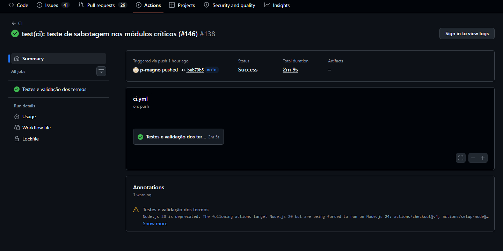

# Relatório de testes e cobertura (R2)

Números medidos na `main` no commit `bab79b5` (22/11/2026), com Node 24 (o do CI) e `npm ci`. Para refazer: `npm ci && npm test && npm run test:cobertura`. A estratégia (camadas, ferramentas e convenções) está nas ADRs [0010](adr/0010-bibliotecas-nos-scripts-do-robo.md) e [0013](adr/0013-analise-de-qualidade-com-sonarqube-cloud.md) e em [`TESTE-DE-SABOTAGEM.md`](TESTE-DE-SABOTAGEM.md); este documento traz só os números. Onde o número depende de um PR ainda aberto, aparece o PR de onde vem; quando o resultado ainda não foi medido, aparece **Pendente**.

## 1. Resumo contra a régua do plano de ensino

| Critério do plano | Régua | Medido | Situação |
|---|---|---|---|
| Cobertura de linhas no domínio | ≥ 70% | **99,41%** (1684 de 1694 linhas) | atingido |
| Escore de mutação | ≥ 50% | **90,90%** no total e **99,20%** no domínio (PR #157, aberto) | atingido no PR; falta entrar na `main` |
| Sabotagem pega nos módulos críticos | 100% | **23 de 23** defeitos quebram a suíte (10 no domínio, 6 no robô, 1 no servidor local, 6 na tela) | atingido |
| Achados altos ou críticos no SAST | 0 | **0** vulnerabilidades, **0** hotspots e nota **A** no SonarQube; `npm audit` com **0** vulnerabilidades | atingido |
| Quality Gate do SonarQube | OK | **OK** (6 condições) | atingido |

"Domínio" = `frontend/js/*.js` sem o `app.js` (a tela, coberta pelo E2E do PR #153) e `coleta/`.

## 2. Testes automatizados (`npm test`)

**244 testes, 244 passam, 0 falham, 0 pulados** em 22 arquivos (o executor do Node não usa `describe`, então reporta 0 suítes). Duração: 5,7 s.

| Arquivo | Testes | O que cobre |
|---|---|---|
| `atualizar-termos.test.js` | 8 | merge dos candidatos no `termos.json`, campos revisáveis e campus padrão |
| `busca.test.js` | 9 | sugestões, teclado, atalhos e trilha na busca |
| `classificador.test.js` | 41 | resposta do LLM, prompts, classificação e filtro |
| `coletor-dpo.test.js` | 23 | PDF real da DPO (fixture), extração, download, `robots.txt` e pausa |
| `coletor-html.test.js` | 27 | coleta HTML, `robots.txt`, user-agent e pausa entre pedidos |
| `dados.test.js` | 1 | `frontend/data/termos.json` segue o schema (ADR 0004) |
| `deduplicar.test.js` | 19 | duplicatas e conflitos entre fontes |
| `ficha.test.js` | 5 | ficha do termo |
| `filtro-de-termos.test.js` | 13 | lista fixa, decisão do LLM e revisão humana |
| `fontes-girias.test.js` | 7 | gírias nas páginas salvas do CEPLAN e da UnB |
| `fronteira-dependencias.test.js` | 2 | fronteira de dependências (ADR 0010) |
| `lista.test.js` | 8 | cartões e filtros da lista |
| `pipeline.test.js` | 2 | classifica só termos novos e para no limite de 100 chamadas |
| `relatorio.test.js` | 16 | relatório da coleta, detecção de mudança e corpo do PR |
| `sabotagem.test.js` | 6 | o próprio teste de sabotagem: quebra, restaura e falha quando precisa |
| `servidor-local.test.js` | 5 | sobe o servidor local em porta livre (integração) |
| `sobre.test.js` | 8 | página Sobre |
| `tema.test.js` | 4 | tema claro e escuro |
| `termos.test.js` | 13 | busca, índice e filtro de campus |
| `trilha.test.js` | 10 | trilha do calouro |
| `validacao-termo.test.js` | 12 | schema do termo e links seguros |
| `workflow-coleta.test.js` | 5 | workflow semanal, permissões e PR do robô |
| **Total** | **244** | |

Por tipo: **187 unitários** (módulos puros, com dados de teste) e **57 de integração** (servidor local, PDF e HTML reais, `termos.json`, workflow e o próprio script de sabotagem). A classificação é pelo que o teste toca, não pela pasta. E2E e aceitação: ver a seção 5.

## 3. Cobertura (`npm run test:cobertura`)

Cobertura do Node (`--experimental-test-coverage`). Ela só mede os arquivos que algum teste importa.

| Arquivo | Linhas % | Ramos % | Funções % | Linhas sem cobertura |
|---|---|---|---|---|
| `coleta/atualizar-termos.js` | 95,77 | 72,73 | 100,00 | 58-60 |
| `coleta/classificador.js` | 100,00 | 96,00 | 93,75 | |
| `coleta/cliente-gemini.js` | 100,00 | 96,15 | 100,00 | |
| `coleta/coletor-html.js` | 98,84 | 94,20 | 90,00 | 74-75 |
| `coleta/coletores/dpo.js` | 98,49 | 96,10 | 100,00 | 116-118 |
| `coleta/deduplicar.js` | 100,00 | 97,01 | 100,00 | |
| `coleta/filtro-de-termos.js` | 100,00 | 94,44 | 100,00 | |
| `coleta/fontes.js` | 98,25 | 95,31 | 100,00 | 22-23 |
| `coleta/pipeline.js` | 100,00 | 100,00 | 100,00 | |
| `coleta/relatorio.js` | 100,00 | 83,54 | 100,00 | |
| `frontend/js/busca.js` | 100,00 | 100,00 | 100,00 | |
| `frontend/js/ficha.js` | 100,00 | 100,00 | 100,00 | |
| `frontend/js/lista.js` | 100,00 | 100,00 | 100,00 | |
| `frontend/js/tema.js` | 100,00 | 100,00 | 100,00 | |
| `frontend/js/termos.js` | 100,00 | 100,00 | 100,00 | |
| `frontend/js/trilha.js` | 100,00 | 90,63 | 100,00 | |
| `frontend/js/validacao-termo.js` | 100,00 | 81,48 | 88,89 | |
| `scripts/classificar.mjs` | 82,35 | 37,50 | 100,00 | 19-21, 29-34 |
| `scripts/sabotagem.mjs` | 97,16 | 94,12 | 91,30 | 124-125, 140-141 |
| `scripts/servidor-local.mjs` | 85,71 | 85,71 | 75,00 | 71-77, 86-91 |
| **Todos os arquivos medidos** | **98,18** | **92,12** | **96,65** | |

Totais calculados somando linhas e ramos do `lcov` (mesmo comando com `--test-reporter=lcov`):

| Conjunto | Linhas | Ramos |
|---|---|---|
| Domínio (`frontend/js` sem `app.js`, mais `coleta/`) | **99,41%** (1684/1694) | **92,84%** (661/712) |
| `frontend/js` (sem `app.js`) | 100,00% (370/370) | 95,32% (163/171) |
| `coleta/` | 99,24% (1314/1324) | 92,05% (498/541) |
| `scripts/` | 90,81% (257/283) | 86,21% (75/87) |
| Todos os arquivos medidos | 98,18% (1941/1977) | 92,12% (736/799) |

**Limite honesto do número:** `frontend/js/app.js` (428 linhas) nenhum teste importa, então não entra no relatório do Node. Ele só passa a ser testado com o E2E do PR #153.

## 4. SonarQube Cloud

Projeto `p-magno_glossario-unb`, análise do commit `bab79b5` em 22/11/2026 (a mesma da `main`).

| Métrica | Valor |
|---|---|
| Quality Gate | **OK** (6 condições) |
| Cobertura (projeto inteiro) | 86,0% |
| Cobertura do código novo | 88,7% (limite do gate: 80%) |
| Linhas de código (ncloc) | 4521 |
| Bugs | 0 |
| Vulnerabilidades | 0 |
| Code smells | 1 (`javascript:S8786` no coletor da DPO, sem impacto no gate) |
| Security hotspots | 0 (100% revisados) |
| Duplicação de linhas | 1,1% |
| Notas de confiabilidade, segurança e manutenibilidade | A (1,0) |

A cobertura do Sonar (86,0%) é menor que a do Node (98,18%) porque o Sonar conta também o `app.js`, que não tem teste ainda, e arquivos que nenhum teste importa.

## 5. Demais camadas

| Camada | Ferramenta | Resultado | Fonte |
|---|---|---|---|
| E2E e acessibilidade | Playwright e axe | **12 testes E2E** e **6 auditorias do axe** (3 páginas × 2 temas) com **0 violações**, CI verde | PR #153 (#78, aberto) |
| Aceitação (BDD/Gherkin) | Cucumber ou Playwright BDD | Pendente | #81 (aberto) |
| Mutação | StrykerJS (`npm run test:mutacao`) | **90,90%** no total, **99,20%** no domínio e **85,70%** no pipeline (cerca de 1.300 mutantes, 5 min) | PR #157 (#82, aberto) |
| Sabotagem | `npm run test:sabotagem` | **23 de 23** defeitos quebram a suíte, no CI da `main` | `main` (`docs/TESTE-DE-SABOTAGEM.md`) |
| Lighthouse | Lighthouse CI | Performance 80 (home), 89 (lista), 93 (termo) e 100 (Sobre); acessibilidade e boas práticas 100 nas 4 páginas; LCP da home em 2,0 s | PR #148 (#80, aberto) |
| Teste com calouros | roteiro manual | PREENCHER | #76 (aberto) |

**Lighthouse:** a última execução do PR #148 (19/11/2026) falhou só no limite de performance da home (80) e da lista (89), ambas abaixo de 90. A acessibilidade e as boas práticas ficaram em 100 nas quatro páginas. A home tem CLS de 0,408; o PR #155 (aberto) ataca o deslocamento de layout.

**Mutação:** o escore foi medido em 20/11/2026, antes de os módulos novos do robô (`dpo.js`, `filtro-de-termos.js`, `pipeline.js`, `relatorio.js` e `atualizar-termos.js`) entrarem na `main`. O número do domínio não deve mudar; o total precisa ser medido de novo depois do merge do PR #157.

## 6. Como bate com o CI

O CI da `main` está verde no commit `bab79b5`:

- [Execução do workflow "CI"](https://github.com/unb-mds/2026-2-GlossarioUnB/actions/runs/44984273347): "Testes e validação dos termos" verde, com `npm test` (244 testes) e `npm run test:sabotagem` (23/23).
- [Análise do SonarQube](https://sonarcloud.io/project/overview?id=p-magno_glossario-unb): Quality Gate OK no mesmo commit.
- Os números das seções 2 e 3 vêm do mesmo comando que o workflow do Sonar roda (`node --test --experimental-test-coverage`).

Print para o slide:

A execução tem 1 aviso (actions ainda em Node 20), sem nenhuma falha.
