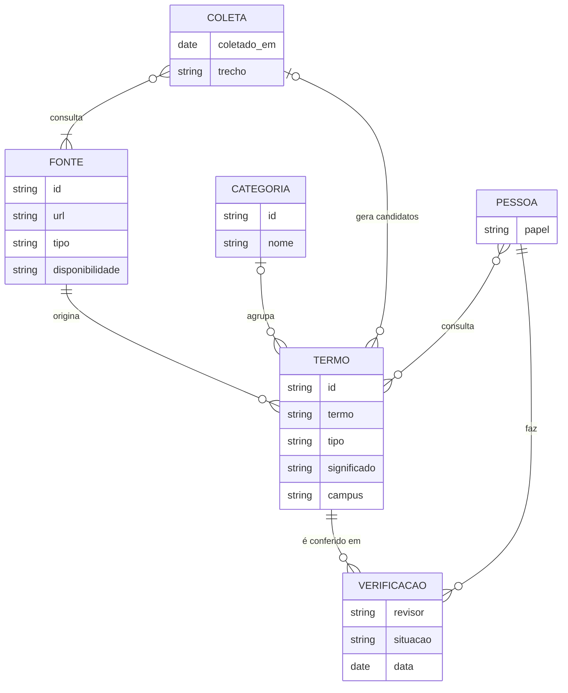

# Documentação dos dados — Glossário UnB

## 1. Objetivo e escopo

Documentar **de onde vêm os dados**, **como são modelados** e **como são validados** antes de irem para o app. Atende à recomendação da retrospectiva da R1 de documentar fontes de dados e decisões de coleta, e ao item de ação “Documentar as fontes” (#52, #61 e #67).

O escopo deste documento é:

- modelo conceitual de um termo;
- dicionário de dados do arquivo `frontend/data/termos.json`;
- disponibilidade e catálogo das fontes usadas hoje.

---

## 2. Modelo conceitual

### 2.1 Entidade principal: `termo`

O domínio do produto é um dicionário de **siglas, gírias e expressões da UnB**. Cada registro representa um termo consumido pela PWA de consulta (`frontend/`).

Como ler o diagrama: `||--o{` liga **um** a **zero ou muitos**; `|o--o{` liga **zero ou um** a **zero ou muitos**; `}o--|{` liga **zero ou muitos** a **um ou muitos**. Em uma frase: cada Termo tem exatamente 1 Fonte, e uma Fonte pode originar vários Termos; cada Termo tem no máximo 1 Categoria, e uma Categoria agrupa vários Termos; um Termo pode ter vindo de 0 ou 1 Coleta, e uma Coleta gera 0 ou mais candidatos consultando 1 ou mais Fontes; e um Termo passa por 0 ou mais Verificações, cada uma feita por 1 Pessoa. O candidato só vira Termo depois da Verificação e do merge; o Termo publicado é materializado em `frontend/data/termos.json`, o arquivo estático que a PWA lê (fluxo na seção 5).

Regras do modelo:

- Não há banco de dados nem backend: o único dataset publicado é `frontend/data/termos.json`.
- O app lê esse arquivo diretamente; não há chamada de API para buscar termos.
- Cada termo tem `id` único, usado na URL de detalhe (`termo.html?id=<id>`).
- Não há duplicidade de termos nem de validação de termo: a regra está só em `frontend/js/validacao-termo.js` (ADR 0004).
- O filtro público do RF02 usa o campo `tipo` (`sigla`, `giria`, `expressao`), não o campo `categoria`.
- O mapa aparece quando existe `localizacao`, independentemente de `categoria`.

### 2.2 Relacionamentos relevantes

- Um termo pertence a um `campus` ou ao campus `Geral` (válido para todos).
- Um termo pode ter `localizacao` (`lat`, `lng`, `link_como_chegar`) se for um lugar físico.
- Um termo pode ter `categoria` (tema em kebab-case) para agrupamentos futuros; a lista ainda está aberta (ADR 0004).
- Cada termo tem `fonte` obrigatória: URL oficial da UnB ou “conhecimento comum verificado pelo grupo”.

---

## 3. Dicionário de dados

| Campo | Obrigatório | Tipo | Valores / regras | Exemplo |
|---|---|---|---|---|
| `id` | sim | string | slug único `a-z0-9-`, usado na URL | `deg` |
| `termo` | sim | string | texto da sigla, gíria ou expressão | `DEG` |
| `tipo` | sim | string | `sigla`, `giria` ou `expressao` | `sigla` |
| `significado` | só se `tipo === "sigla"` | string | forma por extenso da sigla | `Decanato de Ensino de Graduação` |
| `definicao` | sim | string | explicação em português simples | `Decanato responsável por ...` |
| `exemplo_uso` | sim | string | frase real de uso no contexto da UnB | `Minha dúvida foi ao DEG.` |
| `fonte` | sim | string | URL http(s) ou “conhecimento comum verificado pelo grupo” | `https://deg.unb.br/` |
| `campus` | sim | string | `Darcy Ribeiro`, `Ceilândia`, `Gama`, `Planaltina` ou `Geral` | `Geral` |
| `categoria` | não | string | tema em `kebab-case` (lista aberta, pendente de validação da equipe) | `locais-campus` |
| `localizacao` | não | objeto | `{ lat, lng, link_como_chegar }`; link só http(s) | `{ "lat": -15.8, "lng": -47.9, "link_como_chegar": "https://..." }` |

Regras de validação (`frontend/js/validacao-termo.js`, usada por `npm test` e pelo CI):

- Campos obrigatórios não podem estar ausentes nem vazios.
- `id` deve ser slug único no arquivo.
- `tipo` deve ser um dos valores aceitos.
- Sigla precisa de `significado`.
- `campus` deve ser um dos campi válidos.
- `localizacao` é opcional, mas se enviado deve ter coordenadas válidas e link http(s).

Estatísticas atuais de `frontend/data/termos.json` (geradas a partir do arquivo real):

- Total de termos: 56
- Por `tipo`: `sigla` 49, `giria` 1, `expressao` 6
- Por `campus`: `Geral` 54, `Darcy Ribeiro` 2
- Por `categoria`: `locais-campus` 4, `administracao` 2, `vida-academica` 6, `sistemas` 3, `assistencia-estudantil` 3
- IDs duplicados: não
- Termos sem `fonte`: 0
- Termos sem `definicao`: 0
- Termos sem `exemplo_uso`: 0
- Siglas sem `significado`: 0

---

## 4. Disponibilidade das fontes

O catálogo completo, com o que cada fonte oferece e a disponibilidade verificada, está em [`docs/FONTES-DE-DADOS.md`](FONTES-DE-DADOS.md). As seções abaixo resumem o que o pipeline usa e o que já está no dataset publicado.

### 4.1 Fontes configuradas para coleta (`coleta/fontes.json`)

Hoje o pipeline de coleta está configurado com duas fontes oficiais da UnB:

| id | nome | URL | tipo | prioridade | frequência | campus | tipo de termo |
|---|---|---|---|---|---|---|---|
| `unb-decanatos` | Decanatos da UnB | https://unb.br/administrativo-rodape/decanatos | html | 1 | semanal | Geral | sigla |
| `unb-secretarias` | Assessorias e secretarias da UnB | https://unb.br/administrativo-rodape/secretarias | html | 1 | semanal | Geral | sigla |

Orientações de coleta (ADR 0009 e RNF09): respeitar `robots.txt`, esperar pelo menos 1 s entre pedidos, identificar-se pelo user-agent do projeto, e uma fonte com erro não pode parar as outras.

### 4.2 Fontes já usadas no dataset publicado

Cada termo de `frontend/data/termos.json` traz seu próprio campo `fonte`. Resumo do que está publicado hoje:

- 56 termos com fonte preenchida.
- 51 fontes `https://*.unb.br` (páginas oficiais de decanatos, centros, institutos, faculdades, etc.).
- 1 fonte `http://ft.unb.br/`.
- 1 fonte “Conhecimento comum e vivência prática da comunidade acadêmica da UnB (issue #30)” — não é URL; é aceita como conhecimento comum verificado pelo grupo.

Exemplos de fontes oficiais no dataset:

| Fonte | Termos |
|---|---|
| https://deg.unb.br/wp-content/uploads/manual_do_calouro_2026_2.pdf#page=14 | 2 |
| https://deg.unb.br/wp-content/uploads/manual_do_calouro_2026_2.pdf#page=46 | 2 |
| https://arquivocentral.unb.br/ | 1 |
| https://bce.unb.br/ | 1 |
| https://cds.unb.br/ | 1 |
| https://dpo.unb.br/ | 1 |
| https://ru.unb.br/ | 1 |
| (demais fontes oficiais da UnB) | 1 cada |

A lista completa de fontes está no campo `fonte` de cada termo em `frontend/data/termos.json`. O catálogo em `coleta/fontes.json` ainda está incompleto em relação ao dataset publicado; alinhar os dois catálogos é parte das issues #52 e #61.

---

## 5. Fluxo de dados resumido

1. Fontes oficiais (páginas/PDF da UnB) ou conhecimento comum verificado pelo grupo.
2. Coletores extraem candidatos com URL, trecho e data da coleta (`coleta/fontes.json`).
3. Normalização e deduplicação comparam com `termos.json` e separam novos, alterados e conflitos.
4. Opcional: classificador/LLM sugere categoria, tipo e rascunhos; nunca decide sozinho.
5. `validarGlossario()` confere o schema de todos os termos.
6. Pull Request automático aberto por workflow; uma pessoa revisa, escreve/confere definição e exemplo, e faz o merge.
7. `termos.json` na `main` é copiado para o GitHub Pages; a PWA consulta o arquivo estático.

---

## 6. Pendências e próximos passos

- Alinhar `coleta/fontes.json` com as fontes realmente usadas em `termos.json` — issues #52 e #61.
- Ampliar taxonomia e navegação por categoria — issues #63, #64 e #66.
- Implementar verificação periódica de fontes e alerta de termo desatualizado — issue #60.

---

## Referências

- [`docs/adr/0004-schema-unico-do-termo.md`](adr/0004-schema-unico-do-termo.md): schema único e regras de validação.
- [`docs/adr/0009-coleta-automatizada-por-pipeline.md`](adr/0009-coleta-automatizada-por-pipeline.md): pipeline de coleta e PR revisado.
- [`docs/FONTES-DE-DADOS.md`](FONTES-DE-DADOS.md): catálogo das fontes, o que cada uma oferece e a disponibilidade.
- [`docs/REQUISITOS.md`](REQUISITOS.md): RF02, RF05, RF06, RNF05 e fonte de dados.
- [`frontend/js/validacao-termo.js`](../frontend/js/validacao-termo.js): única função de validação de termo.
- [`frontend/js/termos.js`](../frontend/js/termos.js): regras de domínio (busca, filtros, campus e tipos).
- [`coleta/fontes.json`](../coleta/fontes.json): fontes configuradas para coleta.
