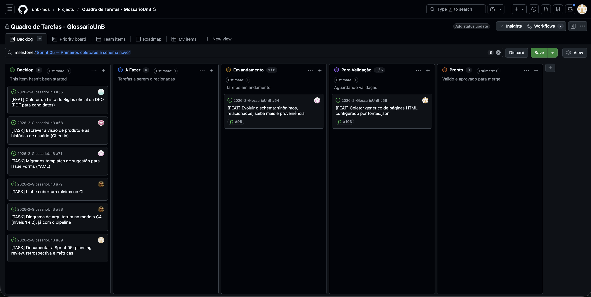
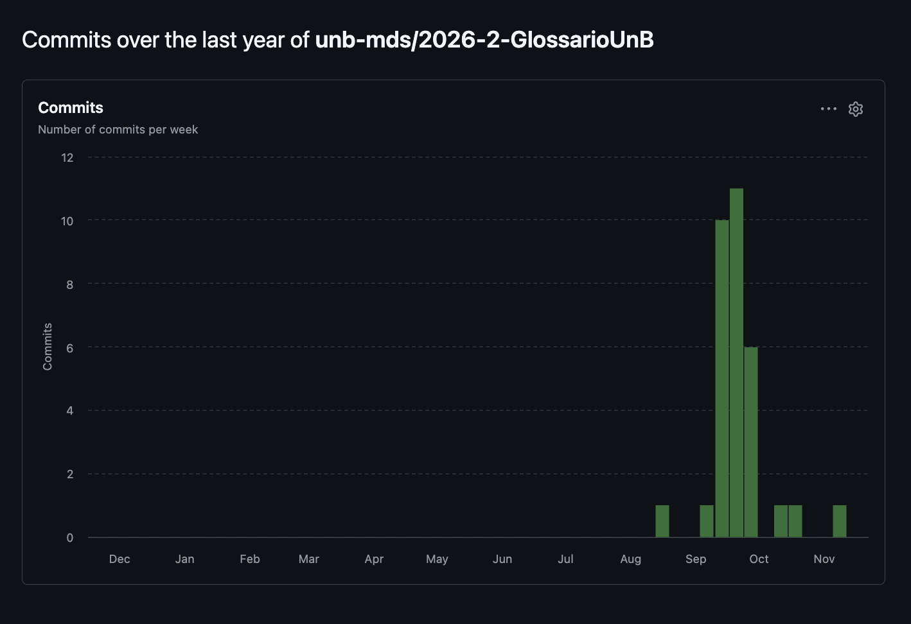

# Sprint 05 — Primeiros coletores e schema novo (19/10 a 25/10/2026)

Registro escrito em 11/11/2026 a partir do GitHub (milestone, issues, PRs e commits) e do `docs/scrum/dailies.md`, porque a sprint não teve registro na época. Responsável por este registro: Pedro (#89).

## Planning

**Objetivo (milestone):** primeiros coletores (PDF da DPO e HTML), schema com sinônimos e relacionados, lint e cobertura no CI.

O planejamento das Sprints 04 a 09 foi dividido na reunião de 12/10 (`dailies.md`: "Definimos as issues da sprint 4 a 9 e dividimos entre os membros"). As issues e os milestones foram criados no GitHub em 21/10, já no meio desta sprint.

| Issue | Tamanho | Pontos | Responsável |
|---|---|---|---|
| #55 Coletor da Lista de Siglas oficial da DPO | L | 3 | Ítalo |
| #56 Coletor genérico de páginas HTML configurado por `fontes.json` | L | 3 | Pedro |
| #64 Evoluir o schema: sinônimos, relacionados, saiba mais e proveniência | M | 2 | José |
| #68 Visão de produto e histórias de usuário (Gherkin) | M | 2 | Jéssyca |
| #71 Migrar os templates de sugestão para Issue Forms | S | 1 | José |
| #79 Lint e cobertura mínima no CI | S | 1 | Allan |
| #88 Diagrama de arquitetura C4 (níveis 1 e 2) | S | 1 | Allan |
| #89 Documentar a Sprint 05 | S | 1 | Pedro |
| **Total** | | **14** | |

Pontos: S = 1, M = 2, L = 3, XL = 5.

## Review

- **Entregue na sprint:** nada. Nenhuma das 8 issues foi fechada, nenhum PR foi mergeado e não houve commit em nenhuma branch entre 19 e 25/10.
- **Fechado sem merge:** o PR #28 (front do MVP), em 21/10, porque o mesmo conteúdo já tinha entrado na `main` pelo PR #39 (29/09).
- **O que ficou e onde está em 11/11:**
  - #64: PR #98, aberto em 28/10, esperando revisão.
  - #56: entrega pronta em 11/11, com os testes de páginas salvas da UnB; o PR abre junto com este registro.
  - #55, #68, #71, #79 e #88: sem PR.
  - #89: este registro.

## Retrospectiva

Feita depois da sprint (11/11), a partir dos registros. Os pontos abaixo vão para a confirmação do time no Encontro 2 (16/11).

**O que funcionou**
- O plano das Sprints 04 a 09 ficou completo: cada issue com tamanho, responsável, critérios de aceitação e definição de pronto.

**O que não funcionou**
- A sprint começou sem as issues no GitHub: elas só foram criadas em 21/10, no terceiro dia.
- Nenhuma reunião foi registrada no `dailies.md` durante a sprint (o último registro é de 12/10).
- PRs da sprint anterior ficaram parados sem merge: #41 (12/10), #45 e #46 (18/10) receberam revisão em 21/10, com pedidos de ajuste, e os ajustes ainda não foram feitos.

**Problemas que se repetem:** a Sprint 04 também terminou com 0 de 15 issues fechadas, e a retrospectiva dela (#42) não foi registrada. "PR parado sem merge" aparece nas duas sprints, então já está no limite de 2 sprints do critério.

**Ações, com responsável**
- [ ] Cada pessoa revisa pelo menos 1 PR por semana. Todos; a primeira rodada vai até 13/11 (combinado do grupo em 09/11).
- [ ] Encontros fixos com registro no `dailies.md` (11, 16, 18 e 24/11, às 13h). Ítalo (Scrum Master).
- [ ] Cada pessoa fecha as próprias issues na ordem das sprints (04, 05, 06…), cerca de uma por dia, com tudo da R2 na `main` até 17/11. Todos (combinado no Encontro 1, 11/11).

## Métricas

Levantadas do GitHub em 11/11/2026 (API de issues, PRs e commits), para a análise do Scrum Master.

| Métrica | Sprint 05 |
|---|---|
| Issues comprometidas | 8 (14 pontos) |
| Issues fechadas | 0 (0 pontos) |
| PRs abertos | 0 |
| PRs mergeados | 0 |
| PRs fechados sem merge | 1 (#28) |
| Commits (todas as branches) | 0 |
| Velocity | 0 pontos |

Commits por pessoa no período: Allan 0, Ítalo 0, Jéssyca 0, José 0, Pedro 0.

**Encaminhamento:** a velocity das Sprints 04 e 05 foi 0, então o time não tem como estimar pela média. Para a R2 (25/11), vale o que for fechado até 17/11, quando tudo precisa estar na `main`.

## Prints

**Quadro do projeto** (issues da Sprint 05). Print de 16/11/2026, três semanas depois do fim da sprint: o #64 (PR #98) e o #56 (PR #103) andaram depois de 25/10.

**Gráfico de commits** (Insights). Print de 16/11/2026: a semana de 19 a 25/10 aparece sem commits.

## Atas

Não há reunião registrada entre 19 e 25/10, então esta sprint não tem ata em `docs/scrum/atas/`.
