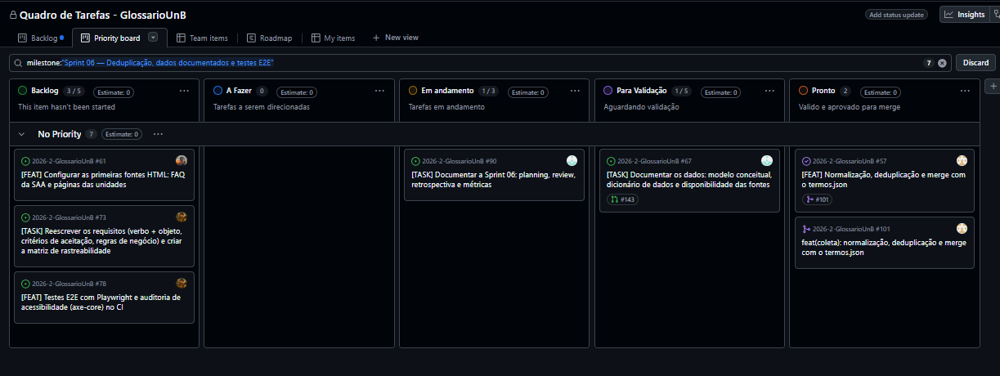

# Sprint 06 — Deduplicação, dados documentados e testes E2E (26/10 a 01/11/2026)

Registro escrito em 19/11/2026 a partir do GitHub (milestone, issues, PRs e commits) e do `docs/scrum/dailies.md`, porque a sprint não teve registro na época. Responsável por este registro: Ítalo (#90).

## Planning

**Objetivo (milestone):** deduplicação, primeiras fontes reais, documentação dos dados, requisitos rastreáveis e testes E2E.

As issues da sprint já estavam no GitHub em 21/10, cinco dias antes do início (26/10), com tamanho, responsável, critérios de aceitação e definição de pronto. Na Sprint 05 elas só foram criadas no terceiro dia da sprint.

| Issue | Tamanho | Pontos | Responsável |
|---|---|---|---|
| #57 Normalização, deduplicação e merge com o `termos.json` | M | 2 | Pedro |
| #61 Configurar as primeiras fontes HTML: FAQ da SAA e páginas das unidades | M | 2 | José |
| #67 Documentar os dados: modelo conceitual, dicionário de dados e disponibilidade das fontes | M | 2 | Ítalo |
| #73 Reescrever os requisitos (verbo + objeto, critérios de aceitação, regras de negócio) e criar a matriz de rastreabilidade | M | 2 | Allan |
| #78 Testes E2E com Playwright e auditoria de acessibilidade (axe-core) no CI | M | 2 | Allan |
| #90 Documentar a Sprint 06 | S | 1 | Ítalo |
| **Total** | | **11** | |

Pontos: S = 1, M = 2, L = 3, XL = 5.

## Review

- **Entregue na sprint:** nada. Nenhuma das 6 issues foi fechada e nenhum PR foi mergeado no período. O único trabalho foi o PR #98, aberto em 28/10 com 3 commits do José, e ele é da issue #64, da Sprint 05.
- **Fechado sem merge:** nenhum.
- **O que ficou e onde está em 19/11:**
  - #57: entregue no PR #101, mergeado em 17/11. Com os 17 candidatos da coleta de 11/11, saíram 12 termos novos, 1 alterado (DPO) e nenhum conflito.
  - #67: PR #143, aberto em 19/11.
  - #61, #73 e #78: sem PR.
  - #90: este registro.
  - #64 (Sprint 05): PR #98 aberto em 28/10 e com revisão de 16/11 pedindo a resolução dos conflitos com a `main` e a restauração das quebras de linha do `frontend/data/termos.json`.

## Retrospectiva

Feita depois da sprint (19/11), a partir dos registros.

**O que funcionou**
- As issues estavam no GitHub antes do início da sprint, com tamanho, responsável e critérios de aceitação — o problema da Sprint 05, em que elas só entraram no terceiro dia, não se repetiu.

**O que não funcionou**
- A sprint terminou sem nenhuma das 6 issues fechada e sem nenhum merge.
- Nenhuma reunião foi registrada no `dailies.md` entre 26/10 e 01/11: o último registro antes da sprint é de 12/10 e o seguinte é de 11/11.
- O único PR do período, #98 (#64), ficou aberto: recebeu revisão em 16/11 com pedido de ajuste e continua sem merge.
- Houve 3 commits no período, todos do José em 28/10 e todos de uma issue da sprint anterior.

**Problemas que se repetem:** fechar as issues dentro do prazo da sprint falhou em três sprints seguidas. A Sprint 04 terminou com 0 de 15 issues fechadas (como registrado na Sprint 05) e a Sprint 05 com 0 de 8; a Sprint 06, com 0 de 6. O critério do time é não repetir um problema por mais de 2 sprints, e este passou de três. "PR aberto sem merge" também se repete: #41, #45 e #46 na Sprint 05 e #98 na Sprint 06.

**Ações, com responsável**
- [ ] Cada pessoa fecha as próprias issues na ordem das sprints, cerca de uma por dia, com o que é da R2 na `main` até 17/11 e depois até 19/11. Todos (combinado nos Encontros de 11/11 e 16/11).
- [ ] Cada pessoa revisa pelo menos 1 PR por semana. Todos; a primeira rodada vai até 13/11 (combinado do grupo em 11/11).
- [ ] Registrar os encontros no `dailies.md` nos horários fixos (11, 16, 18 e 24/11, às 13h). Ítalo (Scrum Master).

## Métricas

Levantadas do GitHub em 19/11/2026 (API de issues, PRs e commits), para a análise do Scrum Master. Os números de issues e PRs são os do período da sprint (26/10 a 01/11).

| Métrica | Sprint 06 |
|---|---|
| Issues comprometidas | 6 (11 pontos) |
| Issues fechadas | 0 (0 pontos) |
| PRs abertos | 1 (#98) |
| PRs mergeados | 0 |
| PRs fechados sem merge | 0 |
| Commits (todas as branches) | 3 |
| Velocity | 0 pontos |

Commits por pessoa no período: Allan 0, Ítalo 0, Jéssyca 0, José 3, Pedro 0.

**Encaminhamento:** a velocity das Sprints 04, 05 e 06 foi 0, então o time não tem como estimar pela média. Vale o combinado de 11/11 e 16/11: fechar as issues pendentes com tudo na `main` até 19/11 e preparar a apresentação da R2 (25/11).

## Prints

Prints de 19/11/2026, anexados em `img/`.

**Quadro do projeto** (issues da Sprint 06).

**Gráfico de commits** (Insights).

## Atas

Não há reunião registrada entre 26/10 e 01/11, então esta sprint não tem ata. O último registro no `docs/scrum/dailies.md` antes da sprint é de 12/10 e o seguinte é de 11/11. A pasta `docs/scrum/atas/` citada na issue não existe no repositório: as reuniões são registradas no próprio `dailies.md`.
