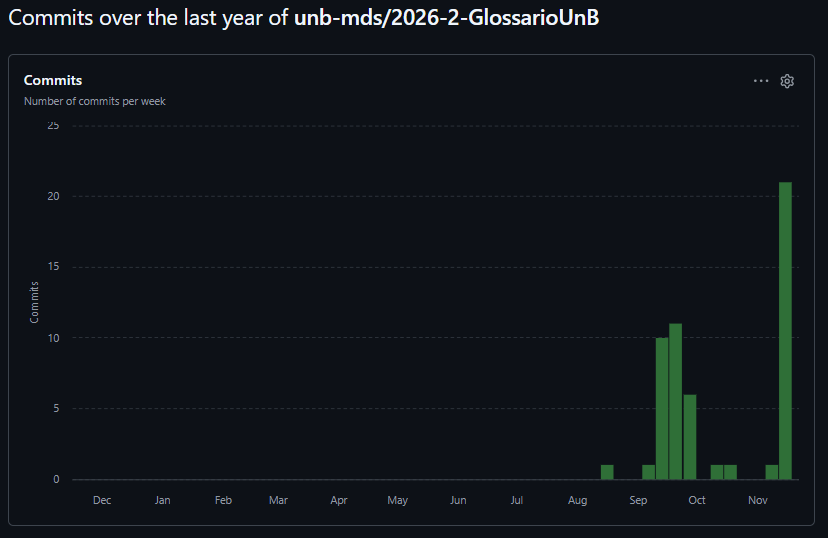

# Sprint 07 — LLM, automação e navegação por categoria (02/11 a 08/11/2026)

Registro escrito em 19/11/2026 a partir do GitHub (milestone, issues, PRs e commits) e do `docs/scrum/dailies.md`, porque a sprint não teve registro na época. Responsável por este registro: Ítalo (#91).

## Planning

**Objetivo (milestone):** classificação com LLM, workflow que abre PR, navegação por categoria, trilha do calouro e testes de aceitação.

As issues da sprint já estavam no GitHub em 21/10, no mesmo lote das Sprints 04 a 09, com tamanho, responsável, critérios de aceitação e definição de pronto.

| Issue | Tamanho | Pontos | Responsável |
|---|---|---|---|
| #58 Categorização e redação assistidas por LLM (API do Gemini) | L | 3 | Pedro |
| #59 Workflow agendado que abre PR com os termos coletados | M | 2 | Ítalo |
| #66 Navegação por categoria, "Veja também" e desambiguação (RF02 e RF09) | M | 2 | José |
| #70 Trilha "Primeiros passos na UnB" na página inicial | M | 2 | Pedro |
| #81 Testes de aceitação BDD: cenários Gherkin executáveis | M | 2 | Allan |
| #91 Documentar a Sprint 07 | S | 1 | Ítalo |
| **Total** | | **12** | |

Pontos: S = 1, M = 2, L = 3, XL = 5.

## Review

- **Entregue na sprint:** nada. Nenhuma das 6 issues foi fechada, nenhum PR foi aberto ou mergeado e não houve commit em nenhuma branch entre 02 e 08/11.
- **Fechado sem merge:** nenhum.
- **O que ficou e onde está em 19/11:**
  - #58: entregue no PR #104, mergeado em 18/11 (o LLM só propõe; a definição final continua com o revisor do PR do robô, conforme a ADR 0009).
  - #70: entregue no PR #124, mergeado em 18/11.
  - #59: PR #144, aberto em 19/11.
  - #66 e #81: sem PR.
  - #91: este registro.

## Retrospectiva

Feita depois da sprint (19/11), a partir dos registros.

**O que funcionou**
- O escopo da sprint já estava definido no GitHub antes do início: as issues foram criadas em 21/10, no mesmo lote das Sprints 04 a 09, com tamanho, responsável, critérios de aceitação e definição de pronto.

**O que não funcionou**
- Não houve commit em nenhuma branch entre 02 e 08/11.
- Nenhuma issue da sprint foi fechada, nenhum PR foi aberto e nenhum PR foi mergeado no período.
- Nenhuma reunião foi registrada no `dailies.md` entre 02 e 08/11: o último registro antes da sprint é de 12/10 e o seguinte é de 11/11.
- Os PRs #41, #45 e #46, revisados em 21/10 com pedidos de ajuste, continuavam abertos no fim da sprint.

**Problemas que se repetem:** fechar as issues dentro do prazo da sprint falhou em quatro sprints seguidas. A Sprint 04 terminou com 0 de 15 issues fechadas (como registrado na Sprint 05), a Sprint 05 com 0 de 8, a Sprint 06 com 0 de 6 e a Sprint 07 com 0 de 6. O critério do time é não repetir um problema por mais de 2 sprints, e este passou de quatro. "PR aberto sem merge" se repete desde a Sprint 04 (#41, #45 e #46) e "nenhuma reunião registrada no `dailies.md`" se repete nas Sprints 05, 06 e 07.

**Ações, com responsável**
- [ ] Cada pessoa fecha as próprias issues na ordem das sprints, cerca de uma por dia, com o que é da R2 na `main` até 17/11 e depois até 19/11. Todos (combinado nos Encontros de 11/11 e 16/11).
- [ ] Cada pessoa revisa pelo menos 1 PR por semana. Todos; a primeira rodada vai até 13/11 (combinado do grupo em 11/11).
- [ ] Registrar os encontros no `dailies.md` nos horários fixos (11, 16, 18 e 24/11, às 13h). Ítalo (Scrum Master).

## Métricas

Levantadas do GitHub em 19/11/2026 (API de issues, PRs e commits), para a análise do Scrum Master. Os números de issues e PRs são os do período da sprint (02/11 a 08/11).

| Métrica | Sprint 07 |
|---|---|
| Issues comprometidas | 6 (12 pontos) |
| Issues fechadas | 0 (0 pontos) |
| PRs abertos | 0 |
| PRs mergeados | 0 |
| PRs fechados sem merge | 0 |
| Commits (todas as branches) | 0 |
| Velocity | 0 pontos |

Commits por pessoa no período: Allan 0, Ítalo 0, Jéssyca 0, José 0, Pedro 0.

**Encaminhamento:** a velocity das Sprints 04, 05, 06 e 07 foi 0, então o time não tem como estimar pela média. Vale o combinado de 11/11 e 16/11: fechar as issues pendentes com tudo na `main` até 19/11 e preparar a apresentação da R2 (25/11).

## Prints

Prints de 19/11/2026, anexados em `img/`.

**Quadro do projeto** (issues da Sprint 07).

**Gráfico de commits** (Insights).

## Atas

Não há reunião registrada entre 02 e 08/11, então esta sprint não tem ata. O último registro no `docs/scrum/dailies.md` antes da sprint é de 12/10 e o seguinte é de 11/11. A pasta `docs/scrum/atas/` citada na issue não existe no repositório: as reuniões são registradas no próprio `dailies.md`.
