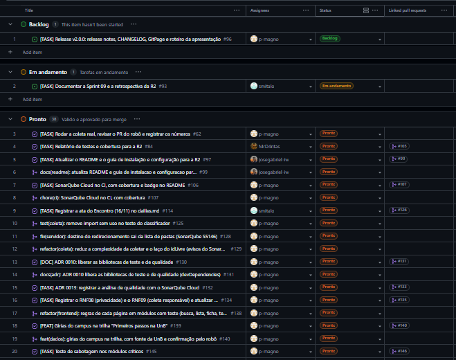
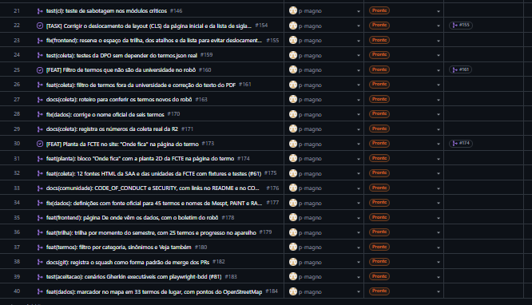
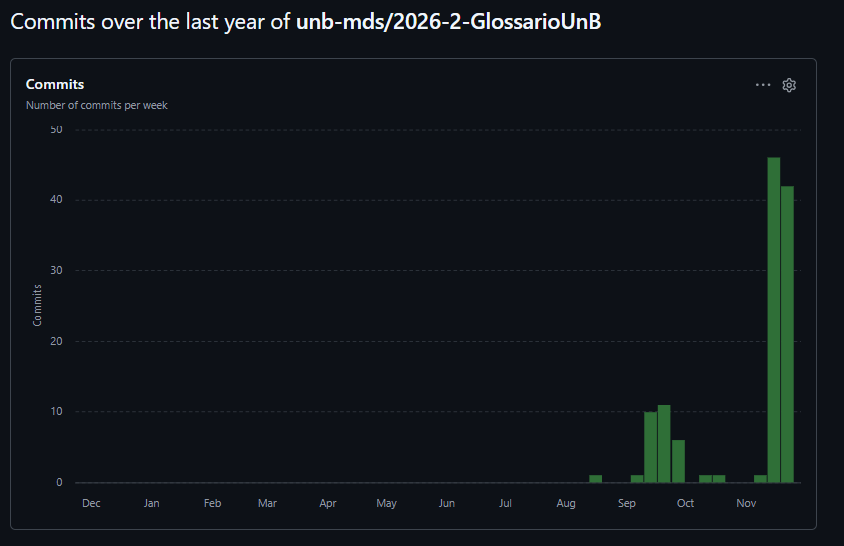

# Sprint 09 — Estabilização e Release 2 (16/11 a 22/11/2026)

Registro escrito em 24/11/2026 a partir do GitHub (milestone 10, issues, PRs e commits) e do [`dailies.md`](../dailies.md). Responsável por este registro: Ítalo (#93), Scrum Master.

## Planning

**Objetivo (milestone):** coleta real revisada, relatório de testes, README final e release v2.0.0. Release 2 em 25/11/2026.

O planejamento inicial das Sprints 04 a 09 foi dividido na reunião de 12/10 e consolidado no [`sprint-planning.md`](../sprint-planning.md). Com o andamento da sprint e as demandas de estabilização, segurança e validação final da Release 2, novos itens técnicos foram incorporados ao milestone ao longo da semana.

### Backlog inicial planejado

| Issue | Tamanho | Pontos | Responsável |
|---|---|---|---|
| [#62](https://github.com/unb-mds/2026-2-GlossarioUnB/issues/62) Rodar a coleta real, revisar o PR do robô e registrar os números | M | 2 | Pedro |
| [#84](https://github.com/unb-mds/2026-2-GlossarioUnB/issues/84) Relatório de testes e cobertura para a R2 | S | 1 | Allan |
| [#93](https://github.com/unb-mds/2026-2-GlossarioUnB/issues/93) Documentar a Sprint 09 e a retrospectiva da R2 | S | 1 | Ítalo |
| [#96](https://github.com/unb-mds/2026-2-GlossarioUnB/issues/96) Release v2.0.0: release notes, CHANGELOG, GitPage e roteiro da apresentação | M | 2 | Pedro |
| [#97](https://github.com/unb-mds/2026-2-GlossarioUnB/issues/97) Atualizar o README e o guia de instalação e configuração para a R2 | S | 1 | José |
| [#106](https://github.com/unb-mds/2026-2-GlossarioUnB/issues/106) SonarQube Cloud no CI, com cobertura e badge no README | S | 1 | Pedro |
| [#114](https://github.com/unb-mds/2026-2-GlossarioUnB/issues/114) Registrar a ata do Encontro (16/11) no `dailies.md` | S | 1 | Ítalo |
| **Total inicial** | | **9** | |

Pontos: S = 1, M = 2, L = 3, XL = 5.

### Itens adicionados ao milestone durante a sprint

Para atender aos critérios de qualidade, arquitetura e robustez da Release 2, o milestone recebeu as seguintes demandas complementares:

| Issue | Tamanho | Pontos | Responsável | Motivação |
|---|---|---|---|---|
| [#130](https://github.com/unb-mds/2026-2-GlossarioUnB/issues/130) ADR 0010: liberar as bibliotecas de teste e de qualidade | S | 1 | Pedro | Formalizar exceção para dependências de desenvolvimento (`devDependencies`) |
| [#132](https://github.com/unb-mds/2026-2-GlossarioUnB/issues/132) ADR 0013: registrar a análise de qualidade com o SonarQube Cloud | S | 1 | Pedro | Formalizar métricas de qualidade e Quality Gate no CI |
| [#134](https://github.com/unb-mds/2026-2-GlossarioUnB/issues/134) Registrar o RNF08 (privacidade) e o RNF09 (coleta responsável) e atualizar equipe | S | 1 | Pedro | Governança de requisitos não funcionais e ajuste de membros ativos |
| [#139](https://github.com/unb-mds/2026-2-GlossarioUnB/issues/139) Gírias do campus na trilha "Primeiros passos na UnB" | S | 1 | Pedro | Incorporação de gírias validadas na experiência inicial do calouro |
| [#145](https://github.com/unb-mds/2026-2-GlossarioUnB/issues/145) Teste de sabotagem nos módulos críticos | M | 2 | Pedro | Verificação de eficácia da suíte de testes com mutantes manuais |
| [#154](https://github.com/unb-mds/2026-2-GlossarioUnB/issues/154) Corrigir o deslocamento de layout (CLS) da página inicial e da lista de siglas (RNF02) | S | 1 | Pedro | Estabilidade visual da interface em auditoria Lighthouse |
| [#160](https://github.com/unb-mds/2026-2-GlossarioUnB/issues/160) Filtro de termos que não são da universidade no robô | M | 2 | Pedro | Mitigação de falsos positivos na extração automatizada de termos |
| [#173](https://github.com/unb-mds/2026-2-GlossarioUnB/issues/173) Planta da FCTE no site: "Onde fica" na página do termo | M | 2 | Pedro | Localização e planta baixa interativa SVG integrada à ficha do termo |
| **Total adicionado** | | **11** | | |
| **Total do Milestone** | | **20** | | |

---

## Review

### 1. Entregas do milestone da Sprint 09

- **Fechadas na janela oficial da sprint (16/11 a 22/11):** 8 issues concluídas (10 pontos):
  - [#106](https://github.com/unb-mds/2026-2-GlossarioUnB/issues/106): fechada em 18/11 pelo PR [#107](https://github.com/unb-mds/2026-2-GlossarioUnB/pull/107) (`60c1840`, Pedro).
  - [#114](https://github.com/unb-mds/2026-2-GlossarioUnB/issues/114): fechada em 18/11 pelo PR [#126](https://github.com/unb-mds/2026-2-GlossarioUnB/pull/126) (`c818f74`, Ítalo).
  - [#130](https://github.com/unb-mds/2026-2-GlossarioUnB/issues/130): fechada em 18/11 pelo PR [#131](https://github.com/unb-mds/2026-2-GlossarioUnB/pull/131) (`fe07eda`, Pedro).
  - [#132](https://github.com/unb-mds/2026-2-GlossarioUnB/issues/132): fechada em 18/11 pelo PR [#133](https://github.com/unb-mds/2026-2-GlossarioUnB/pull/133) (`89dcee3`, Pedro).
  - [#134](https://github.com/unb-mds/2026-2-GlossarioUnB/issues/134): fechada em 18/11 pelo PR [#135](https://github.com/unb-mds/2026-2-GlossarioUnB/pull/135) (`7503dfa`, Pedro).
  - [#139](https://github.com/unb-mds/2026-2-GlossarioUnB/issues/139): fechada em 21/11 pelo PR [#140](https://github.com/unb-mds/2026-2-GlossarioUnB/pull/140) (`2e88dae`, Pedro).
  - [#145](https://github.com/unb-mds/2026-2-GlossarioUnB/issues/145): fechada em 22/11 pelo PR [#146](https://github.com/unb-mds/2026-2-GlossarioUnB/pull/146) (`bab79b5`, Pedro).
  - [#160](https://github.com/unb-mds/2026-2-GlossarioUnB/issues/160): fechada em 22/11 pelo PR [#161](https://github.com/unb-mds/2026-2-GlossarioUnB/pull/161) (`764c672`, Pedro).

- **Fechadas na fase de estabilização pré-R2 (23/11 e 24/11):** 5 issues concluídas (6 pontos):
  - [#154](https://github.com/unb-mds/2026-2-GlossarioUnB/issues/154): fechada em 23/11 pelo PR [#155](https://github.com/unb-mds/2026-2-GlossarioUnB/pull/155) (`706beec`, Pedro).
  - [#84](https://github.com/unb-mds/2026-2-GlossarioUnB/issues/84): fechada em 24/11 pelo PR [#177](https://github.com/unb-mds/2026-2-GlossarioUnB/pull/177) (`d9fc377`, Allan).
  - [#173](https://github.com/unb-mds/2026-2-GlossarioUnB/issues/173): fechada em 24/11 pelo PR [#175](https://github.com/unb-mds/2026-2-GlossarioUnB/pull/175) (`c07e034`, Pedro).
  - [#97](https://github.com/unb-mds/2026-2-GlossarioUnB/issues/97): fechada em 24/11 pelo PR [#99](https://github.com/unb-mds/2026-2-GlossarioUnB/pull/99) (`ff9d63c`, José).
  - [#62](https://github.com/unb-mds/2026-2-GlossarioUnB/issues/62): fechada em 24/11 pelo PR [#171](https://github.com/unb-mds/2026-2-GlossarioUnB/pull/171) (`2510e72`, Pedro).

- **Situação dos itens restantes em 24/11:**
  - [#93](https://github.com/unb-mds/2026-2-GlossarioUnB/issues/93): entregue por este documento e seu PR de documentação (Ítalo).
  - [#96](https://github.com/unb-mds/2026-2-GlossarioUnB/issues/96): PR aberto preparando a consolidação da tag v2.0.0, notas de release e roteiro final da apresentação de 25/11 (Pedro).

### 2. Quitação total do passivo acumulado (Sprints 02 a 08)

Além de avançar no backlog da Sprint 09, a equipe dedicou a janela de 16/11 a 24/11 para eliminar todo o passivo de dívida técnica e funcional acumulado nas sprints anteriores. Foram **41 issues atrasadas fechadas** nesse período:

- **Sprint 02 (2 issues):** [#22](https://github.com/unb-mds/2026-2-GlossarioUnB/issues/22) e [#24](https://github.com/unb-mds/2026-2-GlossarioUnB/issues/24).
- **Sprint 04 (12 issues):** [#41](https://github.com/unb-mds/2026-2-GlossarioUnB/issues/41), [#42](https://github.com/unb-mds/2026-2-GlossarioUnB/issues/42), [#43](https://github.com/unb-mds/2026-2-GlossarioUnB/issues/43), [#44](https://github.com/unb-mds/2026-2-GlossarioUnB/issues/44), [#52](https://github.com/unb-mds/2026-2-GlossarioUnB/issues/52), [#53](https://github.com/unb-mds/2026-2-GlossarioUnB/issues/53), [#54](https://github.com/unb-mds/2026-2-GlossarioUnB/issues/54), [#63](https://github.com/unb-mds/2026-2-GlossarioUnB/issues/63), [#65](https://github.com/unb-mds/2026-2-GlossarioUnB/issues/65), [#77](https://github.com/unb-mds/2026-2-GlossarioUnB/issues/77), [#85](https://github.com/unb-mds/2026-2-GlossarioUnB/issues/85), [#86](https://github.com/unb-mds/2026-2-GlossarioUnB/issues/86), [#87](https://github.com/unb-mds/2026-2-GlossarioUnB/issues/87), [#95](https://github.com/unb-mds/2026-2-GlossarioUnB/issues/95) e [#116](https://github.com/unb-mds/2026-2-GlossarioUnB/issues/116).
- **Sprint 05 (7 issues):** [#55](https://github.com/unb-mds/2026-2-GlossarioUnB/issues/55), [#56](https://github.com/unb-mds/2026-2-GlossarioUnB/issues/56), [#64](https://github.com/unb-mds/2026-2-GlossarioUnB/issues/64), [#68](https://github.com/unb-mds/2026-2-GlossarioUnB/issues/68), [#71](https://github.com/unb-mds/2026-2-GlossarioUnB/issues/71), [#79](https://github.com/unb-mds/2026-2-GlossarioUnB/issues/79), [#88](https://github.com/unb-mds/2026-2-GlossarioUnB/issues/88) e [#89](https://github.com/unb-mds/2026-2-GlossarioUnB/issues/89).
- **Sprint 06 (5 issues):** [#57](https://github.com/unb-mds/2026-2-GlossarioUnB/issues/57), [#61](https://github.com/unb-mds/2026-2-GlossarioUnB/issues/61), [#67](https://github.com/unb-mds/2026-2-GlossarioUnB/issues/67), [#73](https://github.com/unb-mds/2026-2-GlossarioUnB/issues/73), [#78](https://github.com/unb-mds/2026-2-GlossarioUnB/issues/78) e [#90](https://github.com/unb-mds/2026-2-GlossarioUnB/issues/90).
- **Sprint 07 (5 issues):** [#58](https://github.com/unb-mds/2026-2-GlossarioUnB/issues/58), [#59](https://github.com/unb-mds/2026-2-GlossarioUnB/issues/59), [#66](https://github.com/unb-mds/2026-2-GlossarioUnB/issues/66), [#70](https://github.com/unb-mds/2026-2-GlossarioUnB/issues/70), [#81](https://github.com/unb-mds/2026-2-GlossarioUnB/issues/81) e [#91](https://github.com/unb-mds/2026-2-GlossarioUnB/issues/91).
- **Sprint 08 (7 issues):** [#74](https://github.com/unb-mds/2026-2-GlossarioUnB/issues/74), [#75](https://github.com/unb-mds/2026-2-GlossarioUnB/issues/75), [#80](https://github.com/unb-mds/2026-2-GlossarioUnB/issues/80), [#82](https://github.com/unb-mds/2026-2-GlossarioUnB/issues/82), [#83](https://github.com/unb-mds/2026-2-GlossarioUnB/issues/83), [#92](https://github.com/unb-mds/2026-2-GlossarioUnB/issues/92) e [#113](https://github.com/unb-mds/2026-2-GlossarioUnB/issues/113).

Com isso, o projeto atingiu **100% dos épicos planejados para a Release 2** devidamente implementados, testados e documentados na branch `main`.

---

## Retrospectiva da Release 2

Realizada em 24/11/2026, consolidando os aprendizados do ciclo da Release 2 e confrontando com os pontos levantados nas retrospectivas das Sprints 04 a 08.

### O que funcionou

1. **Adoção rigorosa do fluxo GitHub Flow e convenção de branches:** A política *1 issue = 1 branch = 1 PR* alinhada nos Encontros de 11/11 e 16/11 funcionou com perfeição. O time formalizou a convenção de *Squash and merge* na `main` e coautoria com `Co-authored-by` ([#182](https://github.com/unb-mds/2026-2-GlossarioUnB/pull/182)), mantendo um histórico limpo, linear e sem conflitos.
2. **Cultura de revisão técnica e colaboração ativa:** Todos os membros da equipe atuaram ativamente como revisores de PRs alheios, utilizando o padrão formal do G10, inspecionando diffs linha a linha e executando suítes de testes localmente antes de registrar aprovações.
3. **Engenharia de testes e qualidade em múltiplos níveis:**
   - **416 testes unitários e de integração** no Node.js nativo (`node --test`), com tempo de execução inferior a 15 segundos.
   - **Testes ponta a ponta (E2E) e acessibilidade automatizada:** Playwright navegando em múltiplos temas e validação WCAG 2.1 AA via `@axe-core/playwright`.
   - **Testes de aceitação BDD executáveis:** Cenários Gherkin em português (`busca.feature` e `trilha-do-calouro.feature`) executados com `playwright-bdd` ([#183](https://github.com/unb-mds/2026-2-GlossarioUnB/pull/183)).
   - **Teste de sabotagem e mutação:** Proteção contra testes viciados com sabotagem manual nos módulos críticos ([#146](https://github.com/unb-mds/2026-2-GlossarioUnB/pull/146)) e mutação com StrykerJS ([#177](https://github.com/unb-mds/2026-2-GlossarioUnB/pull/177)).
4. **Pipeline de CI/CD 100% automatizado e robusto:** 4 workflows simultâneos no GitHub Actions (Testes de unidade e validação de schema, Lighthouse CI com orçamento de desempenho e CLS, SonarQube Cloud com Quality Gate aprovado e 0 issues, e Testes E2E/Acessibilidade).
5. **Automação responsável e pipeline de IA:** Coletor automatizado semanal ([#59](https://github.com/unb-mds/2026-2-GlossarioUnB/issues/59)/[#144](https://github.com/unb-mds/2026-2-GlossarioUnB/pull/144)) com classificação assistida pela API do Gemini e modelo reserva de contingência, mantendo estrita supervisão humana via PRs abertos pelo robô sem merge automático (ADR 0009).

### O que não funcionou

1. **Concentração excessiva de entregas na reta final:** A baixa atividade registrada nas Sprints 04 a 07 resultou numa carga de trabalho muito concentrada entre 16/11 e 24/11. Apesar do sucesso em entregar todas as metas, o ritmo exigiu esforço desproporcional nos últimos dias do ciclo.
2. **Perda de integrante da equipe:** A saída da integrante Jéssyca exigiu redistribuição emergencial de tarefas no Encontro de 16/11, absorvida pelos quatro membros restantes.
3. **Ajustes emergenciais de alertas do SonarQube:** A introdução de regras estritas pelo SonarQube gerou bloqueios temporários de Quality Gate (como alertas S9383 e S8786 resolvidos no PR [#185](https://github.com/unb-mds/2026-2-GlossarioUnB/pull/185)), que poderiam ter sido prevenidos com linters locais mais rigorosos.

### Conferência de problemas recorrentes

*Critério da equipe: nenhum problema apontado em retrospectiva pode se repetir por mais de duas sprints.*

| Problema apontado anteriormente | Histórico | Situação na Sprint 09 | Veredito |
|---|---|---|---|
| **PR aberto parado sem revisão ou merge** | Apareceu na Sprint 04, repetiu nas Sprints 05 e 08 | **75 PRs mergeados** no período de 16/11 a 24/11, com tempo médio de primeira revisão inferior a 24 horas. | **RESOLVIDO COMPLETAMENTE** |
| **Documentação de sprint e atas em atraso** | Apareceu nas Sprints 04, 05, 06, 07 e 08 | Todas as documentações pendentes (Sprints 04 a 08) foram devidamente regularizadas e a Sprint 09 foi documentada dentro do prazo da R2. | **RESOLVIDO** |
| **Velocity zero ou baixa no período** | Apareceu nas Sprints 04, 05, 06 e 07 | O time entregou **10 pontos** de issues da Sprint 09 na janela oficial e **29 issues fechadas no total** (mais de 60 pontos computando as entregas de backlog). | **RESOLVIDO** |

### Ações para a fase pós-Release 2

1. **Apresentação da Release 2:** Ensaio geral e divisão da fala da equipe para a apresentação presencial de 25/11/2026. *Responsável: Todos.*
2. **Consolidação de release no GitHub:** Geração da tag `v2.0.0` com changelog detalhado e assets compilados ([#96](https://github.com/unb-mds/2026-2-GlossarioUnB/issues/96)). *Responsável: Pedro.*
3. **Plano de sustentação como software livre:** Manutenção do robô de coleta semanal em produção no GitHub Actions e monitoramento das issues submetidas pela comunidade acadêmica. *Responsável: Todos.*

---

## Métricas

Métricas levantadas a partir do repositório no GitHub (`unb-mds/2026-2-GlossarioUnB`), separadas pela janela oficial da Sprint 09 (16/11 a 22/11/2026) e pelo período total de estabilização até a Release 2 (16/11 a 24/11/2026).

| Métrica | Janela Oficial (16/11 a 22/11) | Consolidado até R2 (16/11 a 24/11) |
|---|---|---|
| **Issues comprometidas no milestone** | 15 (20 pontos) | 15 (20 pontos) |
| **Issues do milestone fechadas** | 8 (10 pontos) | 13 (16 pontos) |
| **Total de issues fechadas (todas as sprints)** | 29 issues | 56 issues |
| **PRs abertos no período** | 58 | 79 |
| **PRs mergeados no período** | 43 | 75 |
| **PRs fechados sem merge** | 1 | 2 |
| **Commits na `main` (sem merges)** | 56 | 88 |
| **Velocity (milestone Sprint 09)** | 10 pontos | 16 pontos |
| **Velocity total entregue** | 41 pontos | 78 pontos |

### Commits por integrante no período oficial (16/11 a 22/11)

- **Pedro (`p-magno`):** 25 commits
- **Ítalo (`smitalo` / `monoez`):** 22 commits
- **Allan (`MrD4ntas`):** 3 commits
- **José (`josegabriel-iw`):** 0 commits *(início do ciclo com foco em issues fechadas em 23/11)*
- **Robô `eterno-calouro[bot]`:** 6 commits
- **Total:** 56 commits

### Commits por integrante no consolidado (16/11 a 24/11)

- **Pedro (`p-magno`):** 38 commits
- **Ítalo (`smitalo` / `monoez`):** 24 commits
- **Allan (`MrD4ntas`):** 12 commits
- **José (`josegabriel-iw`):** 7 commits
- **Robô `eterno-calouro[bot]`:** 7 commits
- **Total:** 88 commits

### Encaminhamento

A Sprint 09 representou a maturidade técnica e organizacional definitiva da equipe G10. A superação das três falhas recorrentes (PRs represados, documentação atrasada e baixa velocidade) evidencia que a padronização do fluxo de trabalho e o compromisso coletivo transformaram radicalmente a dinâmica do grupo. O Glossário UnB chega à Release 2 com 100% dos requisitos atendidos, cobertura de testes abrangente, acessibilidade auditada e arquitetura estável.

---

## Prints

Os prints oficiais do quadro do projeto e da atividade de commits foram capturados após o término da sprint para documentação comprobatória da entrega:

**Quadro do Milestone da Sprint 09** ([Milestone 10 — Estabilização e Release 2](https://github.com/unb-mds/2026-2-GlossarioUnB/milestone/10)):

**Gráfico de commits do repositório** ([Insights → Commits](https://github.com/unb-mds/2026-2-GlossarioUnB/graphs/commit-activity)):

---

## Atas

A pasta `docs/scrum/atas/` foi formalmente unificada no arquivo [`dailies.md`](../dailies.md) (decisão de processo registrada no commit `f06b07b`).

Durante a Sprint 09 e a preparação da R2, foram realizadas três reuniões fundamentais registradas no arquivo de dailies:
- **Encontro de 16/11/2026 (Segunda-feira, 13h20 às 13h40):** Apresentação das métricas comparativas pelo Pedro, redistribuição das tarefas de backlog e fixação do prazo de congelamento da R2. Registrado na ata da issue [#114](https://github.com/unb-mds/2026-2-GlossarioUnB/issues/114) (PR [#126](https://github.com/unb-mds/2026-2-GlossarioUnB/pull/126)).
- **Encontro de 18/11/2026 (Quarta-feira, 13h20 às 13h50):** Alinhamento sobre o pipeline de coleta com IA, aprovação das ADRs 0010 e 0013, e validação dos critérios de aceitação e testes de sabotagem.
- **Encontro de 24/11/2026 (Terça-feira, 13h15 às 14h00):** Fechamento das últimas issues da Sprint 09, validação dos 4 checks de CI verdes, ensaio da apresentação e alinhamento do roteiro da Release 2.
